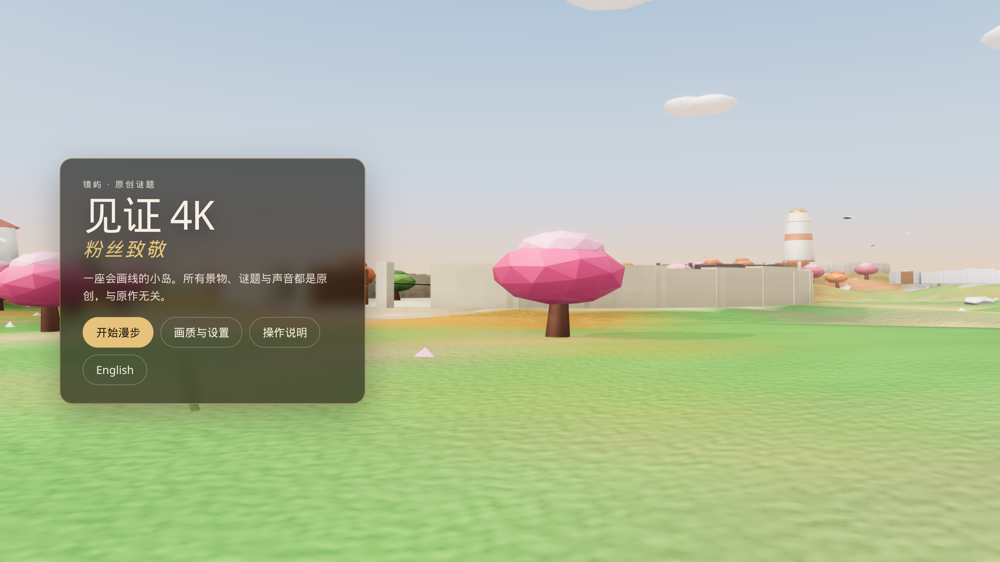
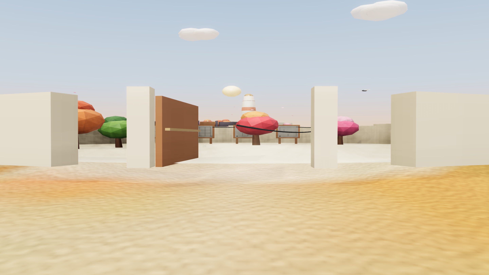
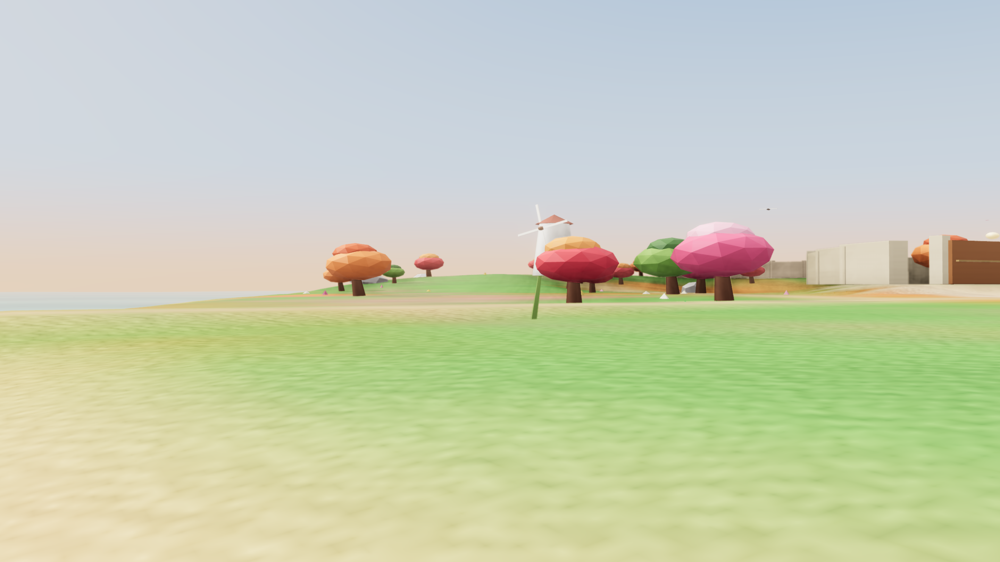
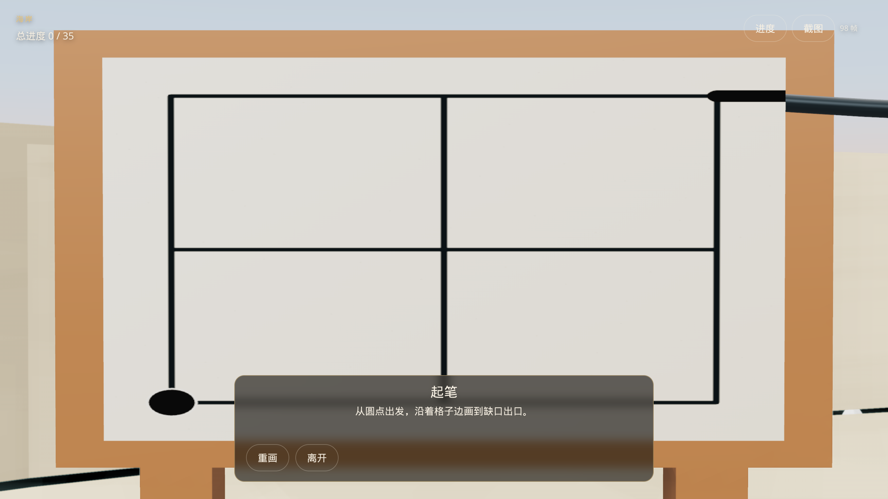
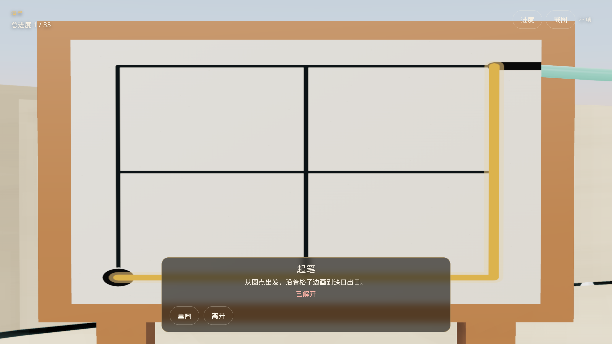
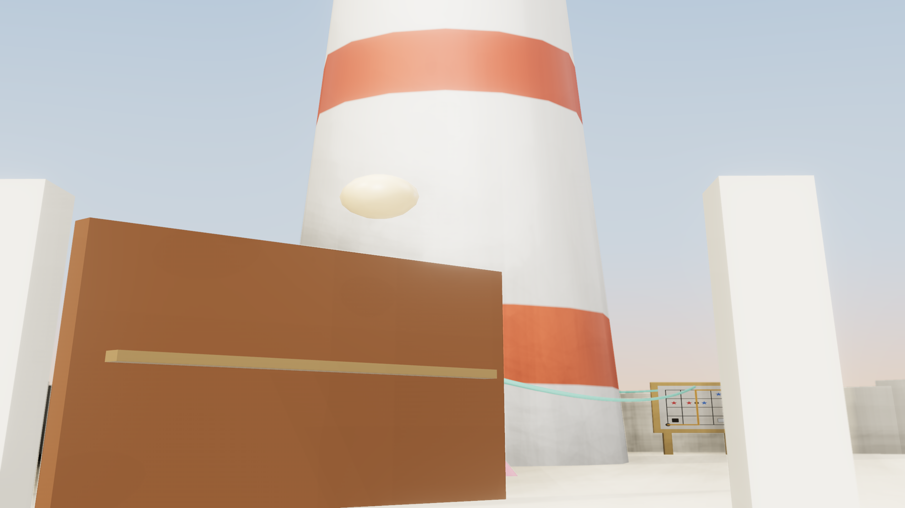

# 见证 4K（粉丝致敬）

**The Witness 4K (fan tribute)** — 镜屿上的第一人称划线谜题。画面、模型、谜题、音效与关卡都是原创，不是官方游戏的复刻，也与 Thekla / Jonathan Blow 无关。

在线玩：[https://zhangjianlin0316-stack.github.io/the-witness-4k/](https://zhangjianlin0316-stack.github.io/the-witness-4k/)

> **GitHub Pages 源必须选 GitHub Actions**（Settings → Pages → Build and deployment → Source: **GitHub Actions**）。仓库根目录的 `.github/workflows/pages.yml` 会在推送到 `main` 时用 `actions/configure-pages`、`actions/upload-pages-artifact`、`actions/deploy-pages` 部署整个静态站点。仓库里有 `.nojekyll`，不经过 Jekyll。

## English summary

A static, browser-playable first-person puzzle island inspired by line-drawing panels. Walk with WASD and mouse-look, step up to a panel, and draw a path from the start circle to the exit. Seven gardens teach broken edges, hex marks, black/white regions, colored stars, polyomino shapes, and vertical symmetry, then a lighthouse ending. Progress is stored in `localStorage`. Graphics presets run from Low through Ultra 4K (full `devicePixelRatio`, large shadow maps, bloom, SSAO). F2 saves a 3840×2160 screenshot. No build step: open `index.html` with any static server. Three.js r170 is vendored under `vendor/three` (MIT).

## 本地游玩

不需要安装依赖，也不需要构建。在仓库根目录执行：

```bash
python3 -m http.server 8000
```

浏览器打开 `http://127.0.0.1:8000/`。请用静态服务器，不要直接用 `file://` 打开（ES Module 需要 HTTP）。

默认界面是中文。标题画面可以切到 English。

## 操作

| 按键 | 作用 |
| --- | --- |
| 点击画面 | 锁定鼠标、环顾 |
| W A S D / 方向键 | 行走 |
| Shift | 加速 |
| 准星对准面板后点击，或按 E | 进入谜题 |
| 按住鼠标沿格子边拖动 | 画线；沿原路退回可撤销 |
| R | 清空当前线条 |
| Esc | 离开谜题，或暂停 |
| Tab | 园子进度 |
| F1 | 操作说明 |
| F2 | 导出 3840×2160 截图 |

线必须从圆点走到出口，不能重复经过同一个顶点，也不能斜着走。走到出口才判定：失败时线会闪红并消退，成功时线变成金色，面板之间的缆线亮起。一座园子全部解开后，下一座园子的门打开。七座园子都完成后，灯塔亮起，并播放一段简短的结尾。

## 规则（由浅入深）

1. **晨曦庭院** — 把线画到出口；断开的边不能通过。
2. **秋果园** — 六角点必须被线经过。
3. **墨白园** — 线把面板分成区域。同一区域里不能既有黑块又有白块，同色可以在一起。
4. **星桥** — 相同颜色的星必须留在同一区域。
5. **石坊** — 带方块符号的区域必须和符号形状完全一致，可以旋转。
6. **镜回廊** — 只画一侧，另一侧镜像；两条线只能在中轴相贴。
7. **灯塔** — 上面几种规则组合在一起。全部解开后进入结尾。

一共 **7 个区域、35 块面板**。进度、画质、语言、音量和灵敏度记在 `localStorage`（键名 `mirror-isle-witness4k-v1`）。

## 画质

标题画面或暂停菜单里的「画质与设置」：

| 预设 | 内容 |
| --- | --- |
| 低 | 像素比不超过 1，1024 阴影，无后期 |
| 中 | 适合一般笔记本争取 60 帧：像素比约 1.25，2048 阴影，轻微辉光 |
| 高 | 像素比约 1.75，4096 阴影，辉光 + SSAO |
| 超高 4K | 使用设备的完整 `devicePixelRatio`，8192 阴影（不超过 GPU 上限），辉光 + SSAO |

渲染使用 ACES 色调映射、PCF 软阴影、MSAA，以及按档位开启的泛光与屏幕空间环境光遮蔽。F2 或右上角「截图」会暂时以 3840×2160 重绘一帧并下载 PNG。

环境声（风、海、持续音）和面板音效都由 WebAudio 实时生成，没有外部音频文件。

## 画面













截图由无头 Chrome（SwiftShader 软件 WebGL）在约 2880×1620 下抓取，真实显卡上的高画质会更锐、阴影更干净。

## 测试

```bash
node tests/validator.test.js
```

校验器覆盖路径、断边、六角点、黑白区域、同色星、方块形状（含旋转）、垂直对称，以及全部 35 块面板的标准答案和故意走错的路径。进度解锁也在同一套测试里。

浏览器测试（需要本机 Chrome）：

```bash
python3 -m http.server 8741
node tests/browser.mjs
```

## 已知限制

- 这是粉丝致敬，不是官方《见证》的关卡、美术或音频。
- 对称谜题只有左右镜像，没有旋转对称。
- 方块形状允许旋转，不允许镜像翻转。
- 超高画质和 4K 截图取决于显卡的最大贴图尺寸；不支持时会降到设备允许的大小。
- 没有触屏或手柄操作。
- 中画质关闭了 SSAO，以保证普通笔记本更接近 60 帧。
